# How to Switch Adapt the Funrise Gazillion Bubbles Hurricane

Version 2.0.0 | Last updated: 22 November 2026

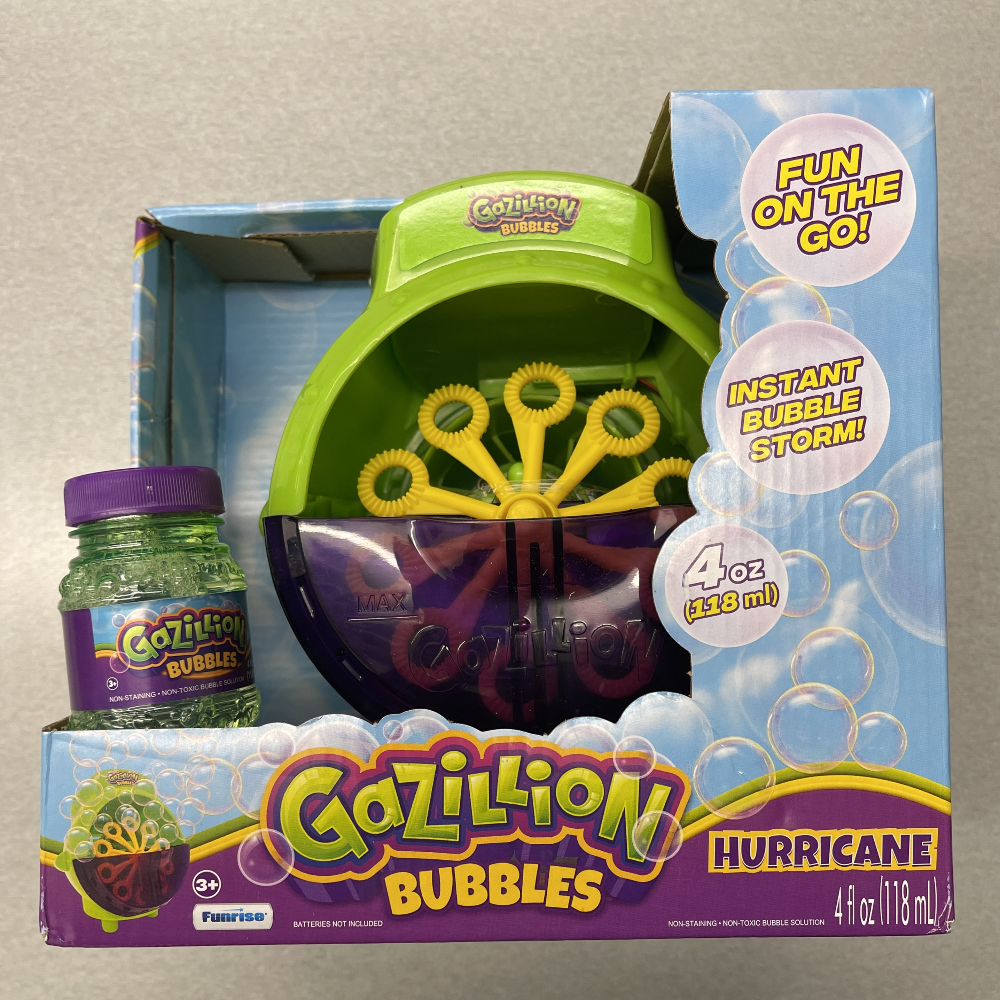

## Introduction

The Funrise Gazillion Bubbles Hurricane is a battery-operated toy that uses a motorized mechanism to produce bubbles.

This adaptation guide explains how to modify the bubble machine to support an external adaptive switch. The modification provides an alternative way to activate the toy while retaining its original functionality.

> For more information, reach out to HuskyADAPT at adaptuw@uw.edu.

### Toy details

| **Detail** | **Information** |
|---|---|
| Name | Funrise Gazillion Bubbles Hurricane |
| Brand | Gazillion |
| Manufacturer | Funrise, Inc |
| Item number | 32417 |
| UPC | 885379904179, 885156898196, 885156908635, 021664324172, 885423477031 |
| Power source | 6 AA batteries |
| Purchase link | [Purchase on Amazon](https://a.co/d/05VLI0Io) |

### Toy features

The following table identifies the sensory outputs involved in operating the toy. Confirm each feature by testing the physical toy.

| Light | Sound | Motion |
|:---:|:---:|:---:|
| [ ] | [x] | [ ] |

### Adaptation difficulty

**Difficulty 2/3: Intermediate**

This project involves modifying the toy's existing electrical circuit and adding an external switch connection. Previous experience with basic electronics and soldering is recommended. An experienced adult should supervise modifications involving electrical tools and components.

### Table of contents

- [Introduction](#introduction)
  - [Toy details](#toy-details)
  - [Toy features](#toy-features)
  - [Adaptation difficulty](#adaptation-difficulty)
  - [Table of Contents](#table-of-contents)
- [General procedure](#general-procedure)
- [Safety precautions](#safety-precautions)
- [Tools and setup](#tools-and-setup)
- [Full procedure](#full-procedure)
  - [Part 1: Preparing the toy](#part-1-preparing-the-toy)
    - [Step 1: Remove the toy from the package](#step-1-remove-the-toy-from-the-package)
    - [Step 2: Assess the toy's functions](#step-2-assess-the-toys-functions)
    - [Step 3: Document the original button](#step-3-document-the-original-button)
  - [Part 2: Understanding the circuit board](#part-2-understanding-the-circuit-board)
  - [Part 3: Making space for the new switch](#part-3-making-space-for-the-new-switch)
  - [Part 4: Soldering](#part-4-soldering)
    - [4.1: Identifying the switch connection](#41-identifying-the-switch-connection)
    - [4.2: Connecting the audio jack cable](#42-connecting-the-audio-jack-cable)
  - [Part 5: Testing and reassembling the adapted toy](#part-5-testing-and-reassembling-the-adapted-toy)
- [Appendix](#appendix)
  - [Troubleshooting](#troubleshooting)
  - [FAQ](#faq)
  - [Resources](#resources)
  - [Acknowledgements](#acknowledgements)
  - [About HuskyADAPT and Instructional Systems](#about-huskyadapt-and-instructional-systems)

## General procedure

The general procedure for toy adaptation is as follows:

1. Unpackage the toy.
2. Assess the toy's functions. Determine what components you want to make switch-accessible.
3. Take the toy apart.
4. Identify the main circuit points responsible for the function(s) selected.
5. Drill a hole into the toy case and feed the switch wires through.
6. Solder an audio jack in parallel to the main circuit.
7. Test the toy.
8. Once it works, put the toy back together.

## Safety precautions

This adaptation requires the use of a soldering iron and drill.

When drilling or soldering:

- Be alert and aware of your surroundings.
- Wear safety goggles.
- Tie back long hair and secure loose-fitting clothing.
- Take all batteries out of the toy.

When soldering:

- Ensure that you are in a well-ventilated room. Turn on a fan if possible.
- Ensure soldering iron cords will not be tripped over.
- Keep your hands away from the iron tip, soldering connection, or anything that has recently touched the tip.

When drilling:

- Drill away from yourself and watch your fingers.

## Tools and Setup

| **Instructions** | **Illustrations** |
|:---|:---|
| **Tools** 1. Electric or hand drill with a drill bit at least 3/8" 2. Small file 3. Small Phillips head screwdriver 4. Test wire 5. Wire strippers (24 AWG)| 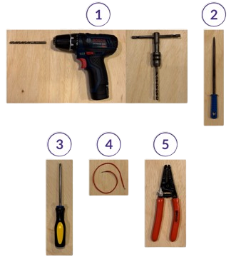 |
|_**Soldering Tools**_ 6. Fan 7. Soldering iron stand 8. High-temperature sponge or brass wool 9. Safety glasses 10. Soldering iron 11. Alligator clip wire holder (optional)|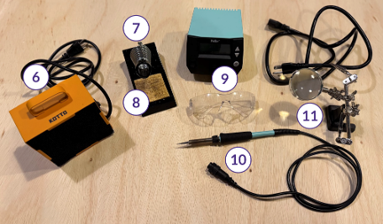|
| **Materials** 12. Audio jack with wire 13. Switch 14. Lead-free solder 15. Soldering tip tinner (optional) | 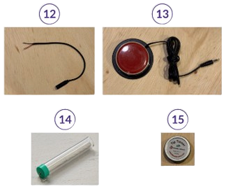 |
|**Setup** Set up a well-ventilated workspace with a clear desk or workbench. Work near an open window, outdoors, or under a vent hood or fume extractor. Plug the soldering iron in and ensure it is easy to reach.|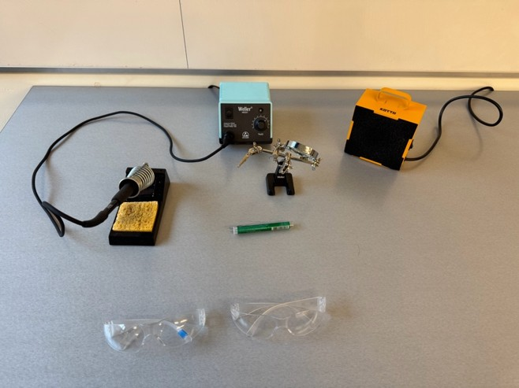|

> **Note:** You will also need a small triangle driver for this adaptation.

## Full procedure

### Part 1: Preparing the toy

#### Step 1: Remove the toy from the package

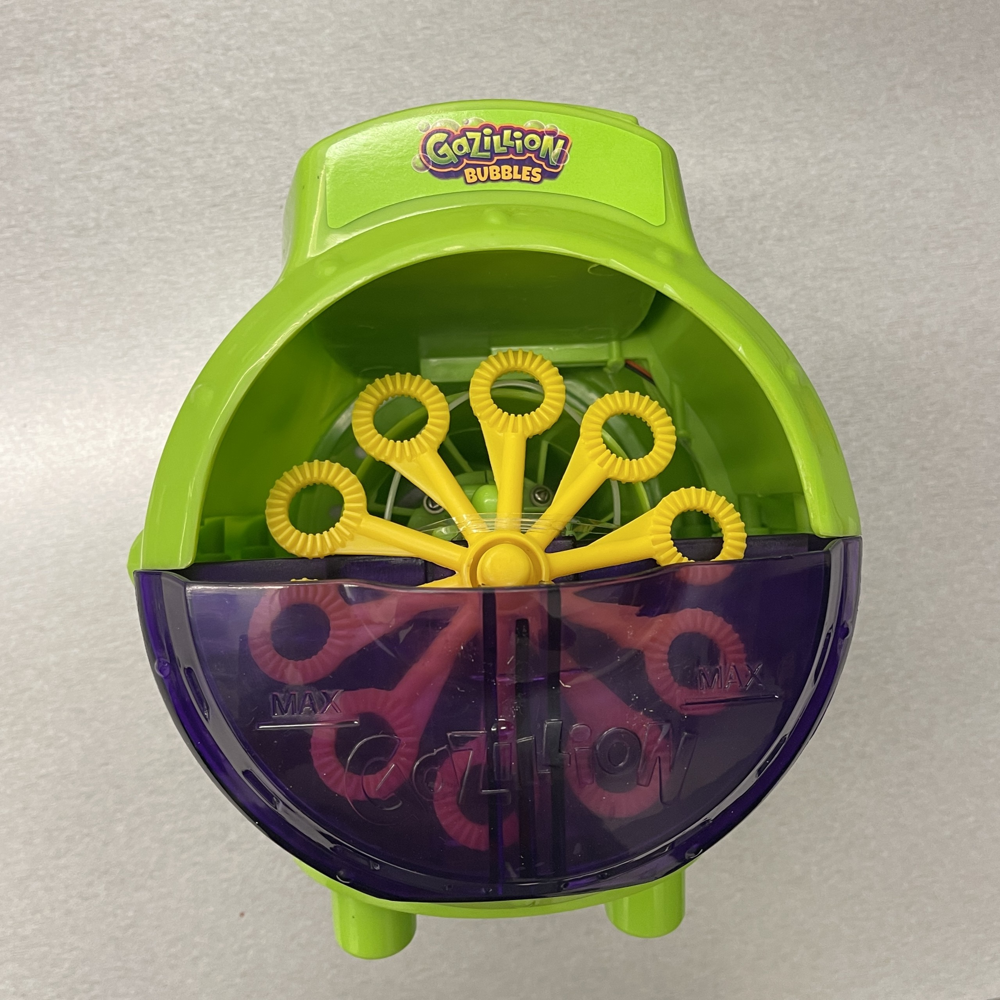

*Figure 1. The Funrise Gazillion Bubbles Hurricane before adaptation.*

- Remove the toy from its packaging.
- Identify the included components and accessories.
- Locate the battery compartment.
- Identify the original switch.
- Locate the bubble reservoir and motorized mechanism.

> **Note:** Take photographs of the toy before beginning the adaptation. Use these photographs as references during reassembly.

---

#### Step 2: Assess the toy's functions

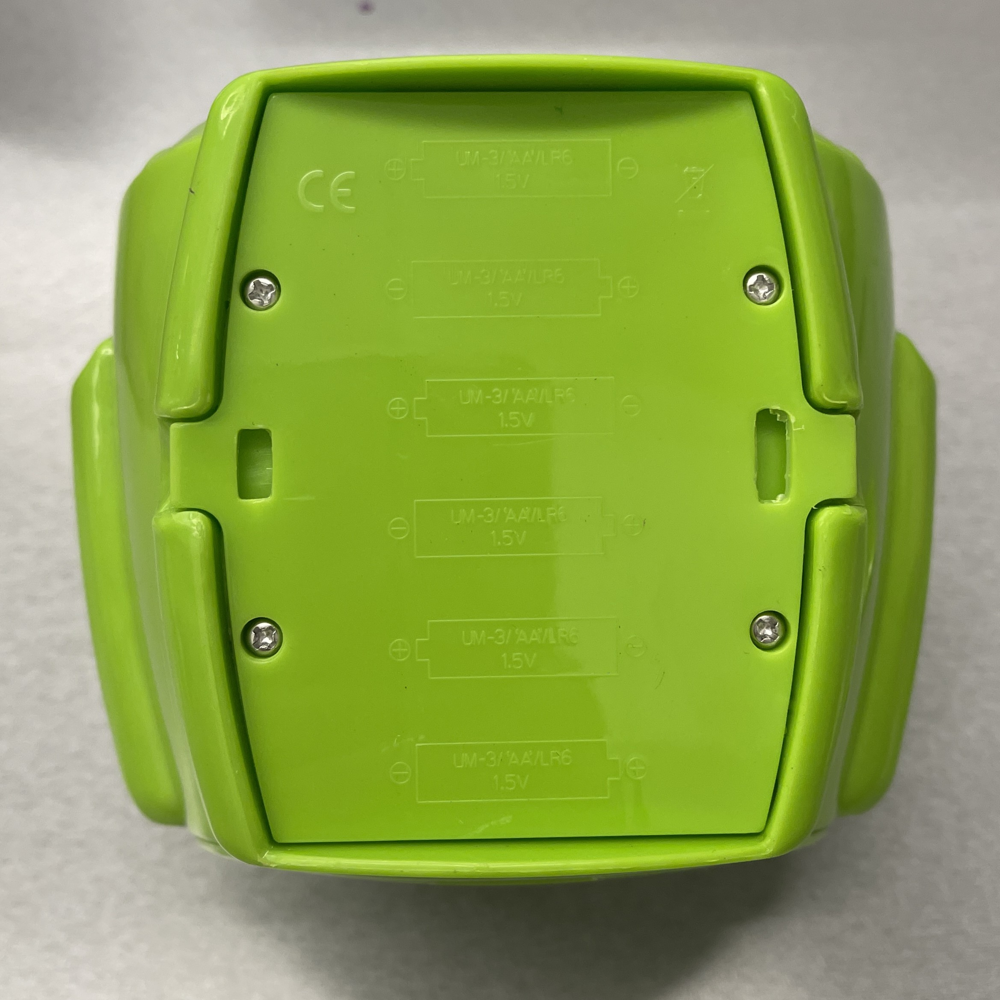

*Figure 2. Battery compartment of the bubble machine.*

- Remove the front bubble liquid compartment.
- Remove the rubber band from the bubble blower.
- Reattach the front bubble liquid compartment.
- Remove the top.
- Unscrew the 4 screws with a Phillips head screwdriver to access the battery compartment.
- Insert 6 AA batteries in the correct orientations.
- Test the original switch.
- Identify the toy's original functions.
- Observe how the bubble-blowing mechanism operates.

> **Tip:** Record the toy's original functionality before making modifications. This provides a reference for testing the adapted toy.

---

#### Step 3: Document the original switch

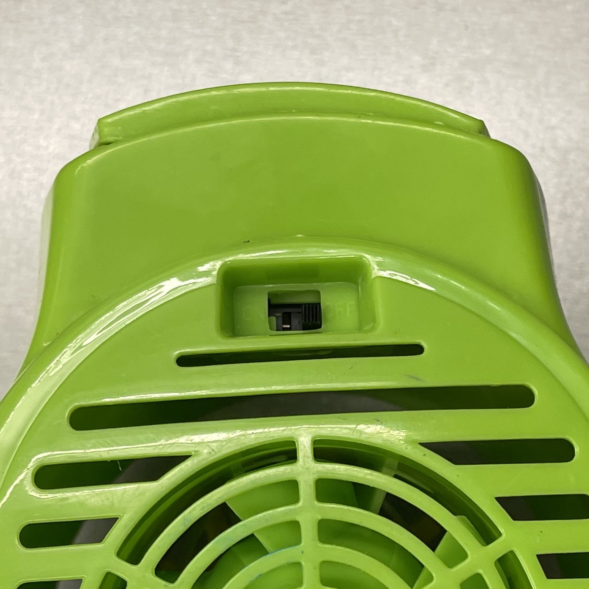

*Figure 3. Original switch of the bubble machine.*

- Document the appearance and location of the original switch.
- Test how the original switch activates the toy.
- Document the toy's original operation.

> **Note:** Document whether the original button activates continuous operation or requires repeated interaction.

---

### Part 2: Understanding the circuit board

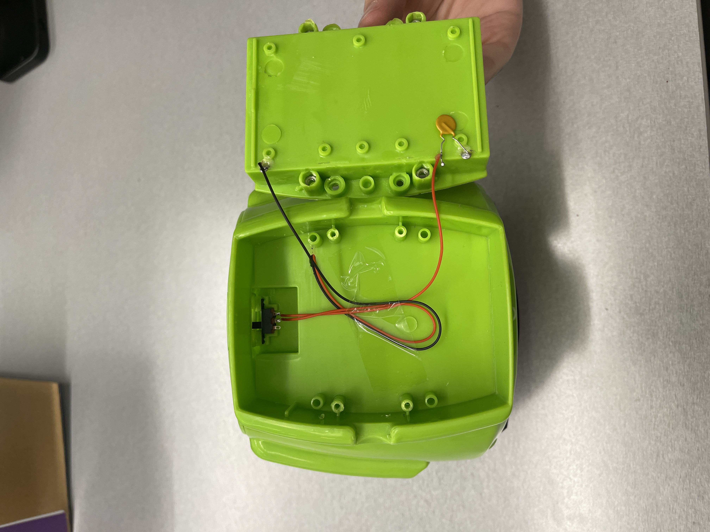

*Figure 4. Internal wiring and original activation circuit.*

- Unscrew the battery compartment using the triangle driver.
- Identify the electrical components responsible for operating the toy.
- Use a test wire to determine how to activate the toy.

Document the following:

- Original switch connections.
- Main circuit points responsible for activation.
- Proposed audio jack connection points.

> **Note:** Confirm the circuit layout using the physical toy before documenting the electrical connections.

---

### Part 3: Making space for the new switch

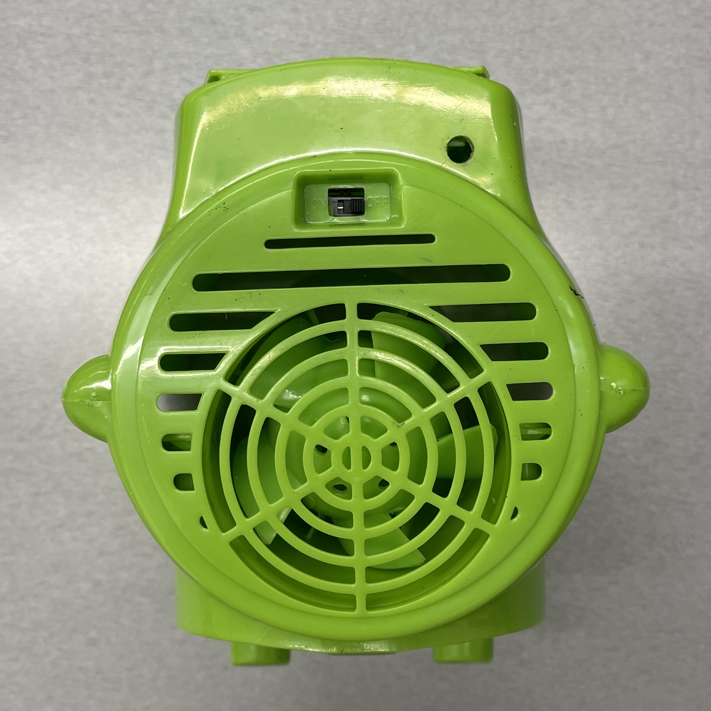

*Figure 5. Proposed location for the audio jack connection.*

- Identify an appropriate location for the audio jack on the toy case.

Document the following:

- Proposed audio jack location.
- Available space within the toy case.
- Clearance from internal components.
- Placement of the audio jack cable.
- Accessibility of the external switch connection.

- Make a hole in the toy using the drill.
- Clean the hole with file.

---

### Part 4: Soldering

Document the electrical modification that connects the external switch to the toy's activation circuit.

#### 4.1: Identifying the switch connection

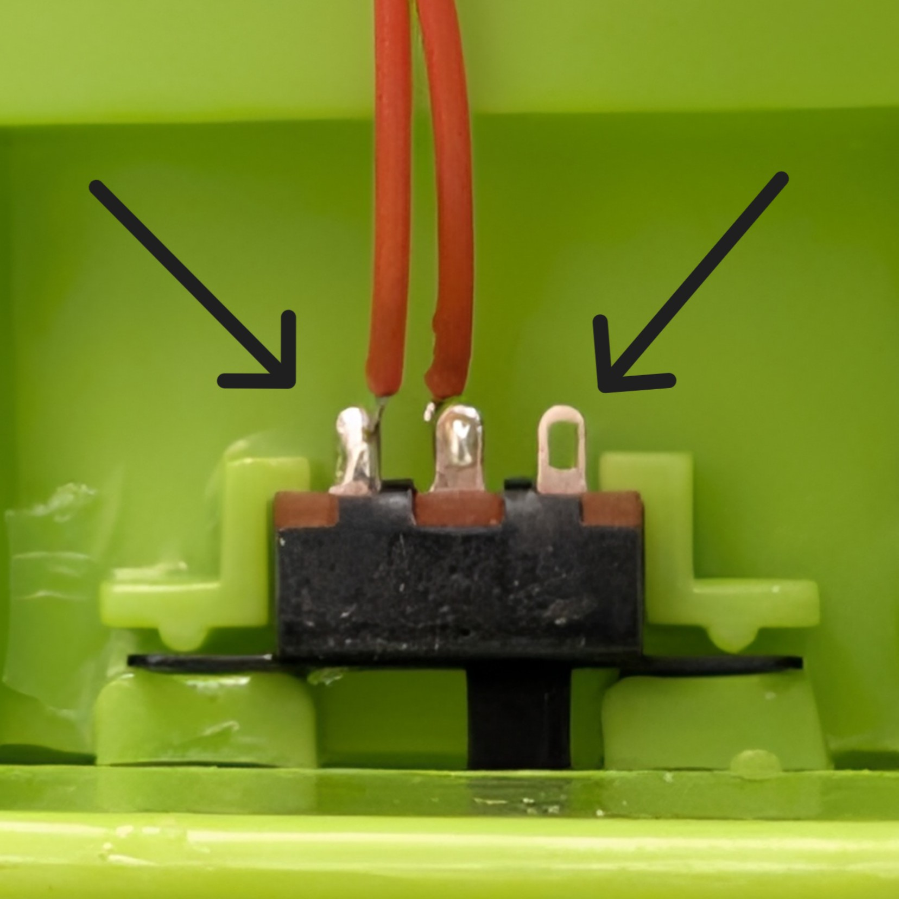

*Figure 6. Circuit board showing the connection points.*

- Verify the connection points from the image above by using the test wire.
- Remove the batteries.

#### 4.2: Connecting the audio jack cable

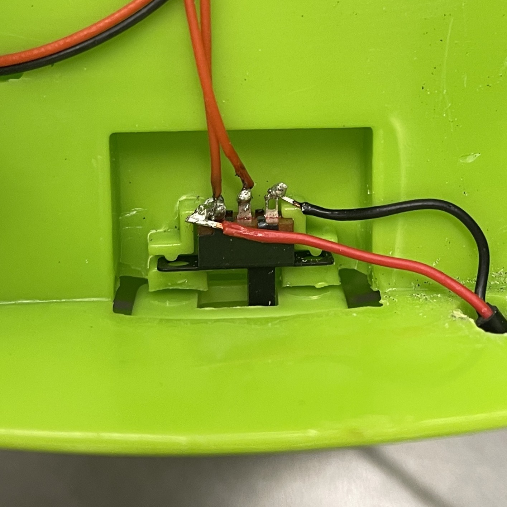

*Figure 7. Completed audio jack cable connection.*

- Thread the audio jack cable wire through the hole made in [Part 3](#part-3-making-space-for-the-new-switch).
- Solder the wires to the two connection points marked in [Step 4.1](#41-identifying-the-switch-connection)

> **Note:** Never solder when the batteries are still in the toy.

---

### Part 5: Testing and reassembling the adapted toy

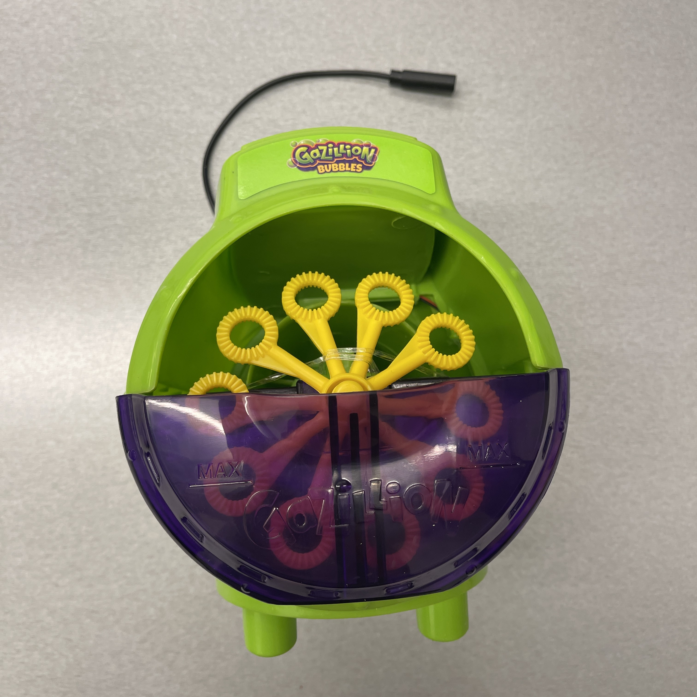

*Figure 8. Completed Funrise Gazillion Bubbles Hurricane adaptation.*

- Test the adapted toy to confirm that the external switch operates as intended.
- Reattach the battery compartment using the triangle driver.
- Reattach the battery compartment lid using the Phillips screwdriver.
- Reattach the top.

Complete the following checks:

- [ ] The original button functions as intended.
- [ ] The external switch activates the toy.
- [ ] The bubble-blowing mechanism operates correctly.
- [ ] The audio jack connection remains secure.
- [ ] The electrical components are properly enclosed.
- [ ] The toy case is securely reassembled.
- [ ] The toy operates without obstruction.

> **Note:** Verify the electrical connections against the actual circuit before testing the adapted toy.

> **Tip:** Compare the adapted toy's functionality with its original operation to identify any changes introduced during the adaptation.

## Appendix

### Troubleshooting

Use the following table to document common issues encountered during testing.

| **Issue** | **Component to inspect** |
|---|---|
| Toy does not turn on. | Battery compartment and original activation circuit. |
| External switch does not activate the toy. | Audio jack cable and external switch connection. |
| Original button does not function. | Original button connections. |
| Bubble mechanism does not operate. | Motorized mechanism and internal connections. |
| Audio jack is loose. | Audio jack placement and enclosure. |

### FAQ

**What toy does this manual adapt?**

The Funrise Gazillion Bubbles Hurricane, manufactured by Funrise, Inc.

**What is the purpose of the adaptation?**

The adaptation provides an alternative method of activating the bubble machine using an external adaptive switch.

**What is an audio jack cable?**

An audio jack cable is the black cable used to connect an external switch to the adapted toy.

**Does the original button remain functional?**

The intended adaptation preserves the original button functionality. Confirm this during testing.

**What power source does the toy use?**

The toy uses four AA batteries.

### Resources

- [HuskyADAPT](https://depts.washington.edu/adaptuw/)
- [Funrise, Inc.](https://www.funrise.com/)
- [Gazillion](https://www.gazillion.com/)
- [Enabling Devices](https://enablingdevices.com/)

### Acknowledgements

This manual was developed as part of HuskyADAPT's toy adaptation efforts.

**Contributors:**
- Manual authors: [Helen Nguyen, Avik Spurgeon, Joshua Vo, Kyla Wang]
- Editors and reviewers: [Helen Nguyen, Avik Spurgeon, Joshua Vo, Kyla Wang]
- Photography: [Helen Nguyen, Avik Spurgeon]

### About HuskyADAPT and Instructional Systems

HuskyADAPT is a University of Washington initiative focused on improving accessibility through adaptive technology, inclusive design, and community engagement.

Instructional Systems supports the development of accessible, understandable, and consistent instructional materials. These manuals document adaptation procedures and promote accessible, reproducible instructions.

For additional information, contact HuskyADAPT at adaptuw@uw.edu.
