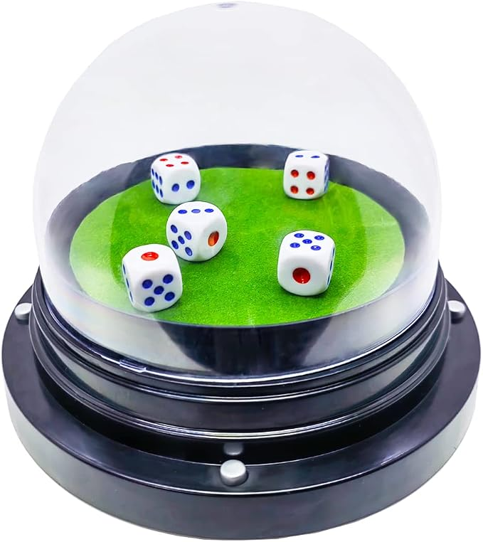
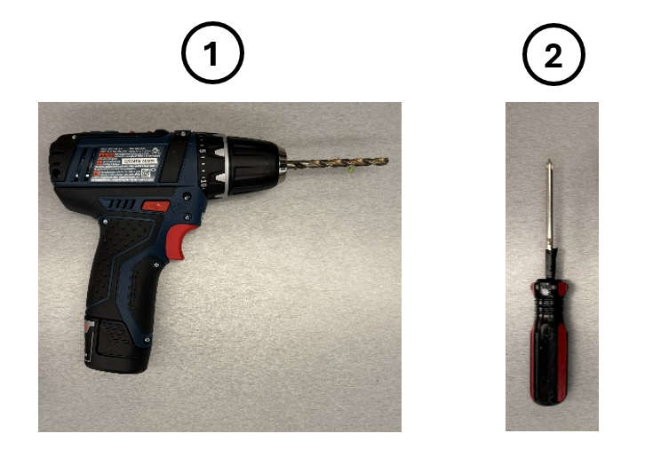
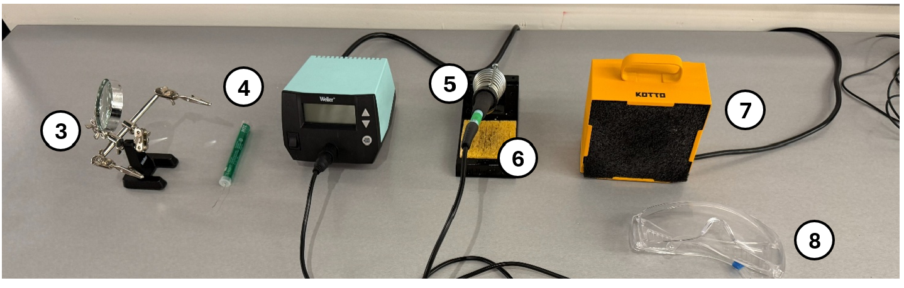
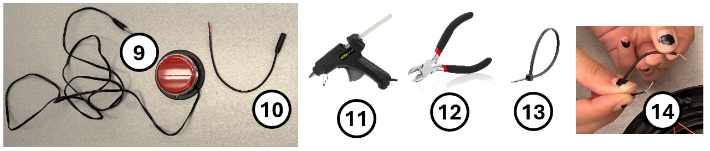
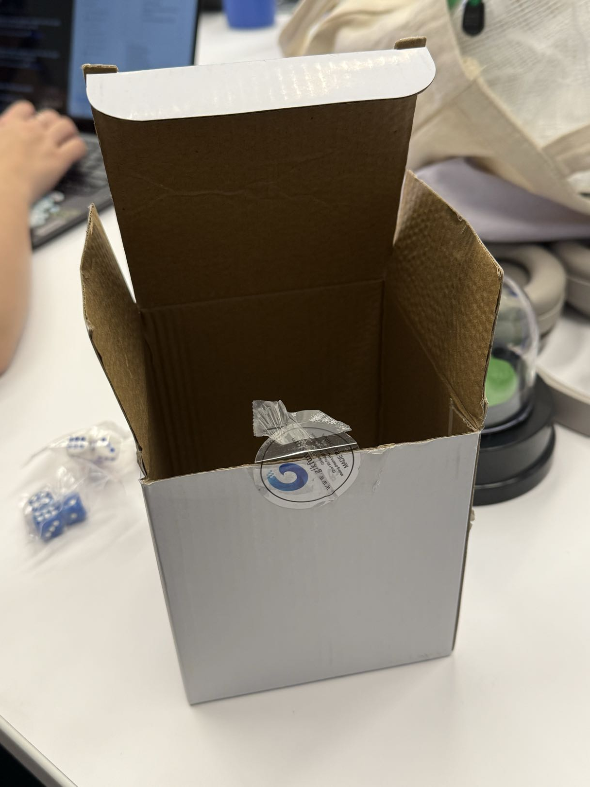
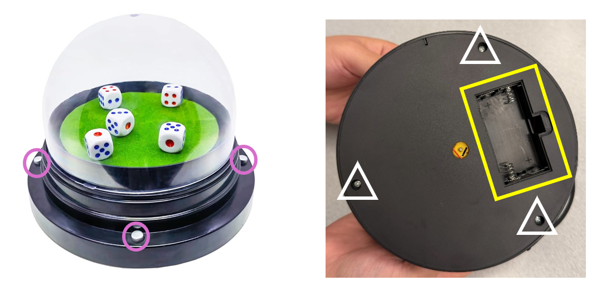
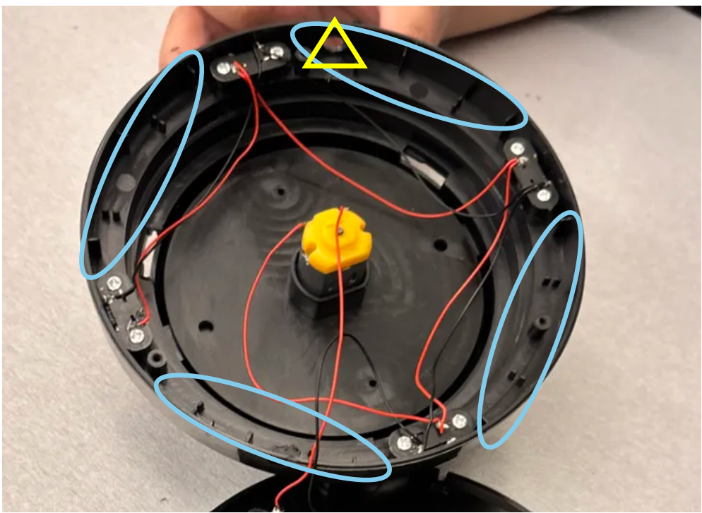
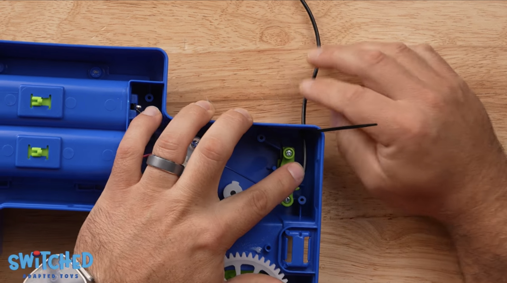

<!-- Phrased for SEO/AEO/GEO -->
# How to Adapt Dice Roller

<!-- AWESOME version no. and date -->
<!-- How to number should go in style guide -->
Version 1. Last updated on 22 November 2026.

<!-- Many teams included alt text eyyy -->

 

<!-- YMCV key intro info -->
# Introduction
* The dice roller is a toy with a spinner inside that rolls dice and is activated with a press of one of four buttons. It can be used for playing all sorts of games including table top roleplaying games like Dungeons and Dragons, board games like Monopoly, and strategy games like Mahjong, among others. 
* This adaptation guide explains how to adapt the functionality of any of the four buttons used to make the dice roll, so that they can be activated with the press of a singular, large button. 

<!-- KALM good standard inclusion -->
> For more information, reach out to HuskyADAPT at adaptuw@uw.edu.

<!-- KALM good standard info -->
## Toy details
**Link**: [Amazon link to dice roller](https://a.co/d/0alVkROF)  
**Name**: Automatic Dice Roller Cup with Dices for Adults Party Table Games EK1981  
**Brand**: Gikfun  
**ASIN**: B0BNT3Z7QN

## Toy features
| Light | Sound | Motion |
|:---:|:---:|:---:|
|💡|🔊|🔃|
|❌|✅|✅|

Pressing any of the four buttons on the dice roller makes the spinner inside to spin, causing the dice to roll and make a rattling sound.
## Adaption difficulty
**Difficulty 1/3: Beginner-friendly**

This project requires beginner-level soldering and hand-tool usage. 

<!-- Linky like AWESOME -->
<!-- Phrased for SEO/AEO/GEO -->
<!-- https://marketplace.visualstudio.com/items?itemName=huntertran.auto-markdown-toc -->
# Table of contents
- [How to Adapt Toy Name](#how-to-adapt-toy-name)
- [Introduction](#introduction)
    - [Toy details](#toy-details)
    - [Toy features](#toy-features)
    - [Adaption difficulty](#adaption-difficulty)
- [Table of contents](#table-of-contents)
- [General procedure](#general-procedure)
- [Safety precautions](#safety-precautions)
- [Tools and setup](#tools-and-setup)
- [Full procedure](#full-procedure)
    - [Part 1: Preparing the toy](#part-1-preparing-the-toy)
        - [Step 1: Remove the toy from the package](#step-1-remove-the-toy-from-the-package)
        - [Step 2: Note key points on the toy](#step-2-declarative-step)
        - [Step 3: Press all buttons to assess the functionality of the toy.](#step-3-declarative-step)
    - [Part 2: Understanding the circuit board](#part-2-understanding-the-circuit-board)
    - [Part 3: Making space for the new switch](#part-3-making-space-for-the-new-switch)
    - [Part 4: Soldering](#part-4-soldering)
        - [4.1: Prepare and apply flux to the wires](#41-custom-soldering-1)
        - [4.2: Solder the wires to the activation points](#42-custom-soldering-2)
    - [Part 5: Testing and reassembling the adapted toy](#part-5-testing-and-reassembling-the-adapted-toy)
- [Appendix](#appendix)
    - [Troubleshooting](#troubleshooting)
    - [FAQ](#faq)
    - [Resources](#resources)
    - [Acknowledgements](#acknowledgements)
    - [About HuskyADAPT and Instructional Systems](#about-huskyadapt-and-instructional-systems)

<!-- Present in every manual for convenience and safety -->
<!-- Should go in the style guide (up for editing) -->
# General procedure
<!-- Source: https://uwnetid.sharepoint.com/:p:/s/huskyadapt/cQr_xZxmDFQlSrafDVBPPkZsEgUCJVXRQgi2niDiJS1xfOS7MA -->
The general procedure for toy adaptation is as follows:  

1. Unpackage the toy.
2. Assess the toy's functions. Determine what components you want to make switch-accessible.  
3. Take the toy apart.  
4. Identify the main circuit points responsible for the function(s) selected.
5. Drill a hole into the toy case and feed the switch wires through.
6. Solder an audio jack in parallel to the main circuit.  
7. Test the toy.  
8. Once it works, put the toy back together.

<!-- Present in every manual for convenience and safety -->
<!-- Should go in the style guide (up for editing) -->
# Safety precautions
This adaptation requires the use of a soldering iron and drill.  

### When drilling or soldering:
- Be alert and aware of your surroundings.
- Wear safety goggles.
- Tie back long hair and secure loose-fitting clothing.
- Take all batteries out of the toy.

### When soldering:
- Ensure that you are in a well-ventilated room. Turn on a fan if possible.
- Ensure soldering iron cords will not be tripped over.
- Keep your hands away from the iron tip, soldering connection, or anything that has recently touched the tip.

### When drilling:
- Drill away from yourself and watch your fingers.  

# Tools and setup
## Tools

1. Electric drill with a drill bit at least 3/8"  
2. Small Phillips head screwdriver  

### Soldering Tools
 

3. Alligator clip wire holder (optional)  
4. Lead-free solder  
5. Soldering iron and stand  
6. High-temperature sponge or brass wool  
7. Fan  
8. Safety glasses  

## Extra Materials

9. Switch  
10. 3.5mm headphone jack  
11. Glue gun
12. Wire cutter
13. Zip tie
14. Test wire

## Setup

<figure>
    
    <figcaption>Example setup</figcaption>
</figure>

Set up a well-ventilated workspace with a clear desk or workbench. Work near an open window, outdoors, or under a vent hood or fume extractor. Plug the soldering iron in, set it on the stand, and ensure it is easy to reach.

<!-- Kept linear for screen reader convenience and less whitespace -->
# Full procedure
## Part 1: Preparing the toy

<!-- Subsection as heading allows for clearer distinction of which images belong to which step -->
### Step 1: Remove the toy from the package

*1.1: The Dice Roller packaging*  

> ✏️ **Note**: If you intend to donate the toy after adapting, be careful not to damage the packaging, as unboxing is a big part of the gift opening experience.

<!-- Separators from KALM; good visual separation between steps -->
---

### Step 2: Note the points marked in Fig. 1.2:

*1.2: Top and bottom of the toy*  

- **Purple circles**: 4x buttons to activate the toy
- **White triangles**: 3x base attachment screws
- **Yellow Rectangle**: 1x battery compartment

---

### Step 3: Assess the functionality of the toy. 

Press all buttons (indicated by purple circles in Fig. 2.2), one by one, to assess the functionality of the toy. 

> ✏️ **Note**: If the buttons do not activate the toy, you may need to open the battery compartment (refer to Fig 2.2) and insert or replace batteries.

---

## Part 2: Understanding the circuitry

<!-- Many teams used the quotation function for visual callouts (slay) -->
<!-- YMCV provided emojis! -->

### Step 1: Remove the base attachment screws
Use the Phillips screwdriver to remove the 3 base attachment screws (refer to Fig. 1.2 for their positions)

*2.1: Opening the bottom of the toy using a screwdriver*

> 💡 **Tip**: Store the removed screws in a safe place, like a small cup, so as not to lose them while adapting the toy.

### Step 2: Remove the base of the toy

Carefully remove the base from the toy body to expose its internal components.

*2.2: The internal layout of the toy*

### Step 3: Test activation points
> ✏️ **Note**: Unlike many toys, this dice roller does not route these connections through a circuit board.

This dice roller has connection points where wires connect to components. Identify all 4 black and red wire pairs that share the same connection point. Each pair corresponds to a button.

<!-- Insert image pointing out connection points, and example of black and red pair. -->
*2.3: Location of 4 black and red wire pairs that connect to components*

To test activation points, briefly bridge the black and red points in its pair with a test wire that has exposed metal at both ends. The corresponding button will activate.

*2.4: Test activation points by using a test wire*

### Step 4: Identify the two pins you wish to connect.
This would correspond to the next part of the manual where you make space for the new switch.

---

## Part 3: Making space for the new switch

### Step 1: The adapted toy will have a headphone jack with its leads soldered to the activation points of the toy (refer to [Part 2](#part-2-understanding-the-circuitry)) that connects to a switch. 

This means that you will need to drill a hole in the toy and thread the headphone jack cable through it. Identify a good spot to drill through (the placement of the cable must not disturb the toy’s circuitry and functionality)

*3.1: Location of our drilled spot and other viable spots*

- **Yellow triangle**: Our drilled spot
- **Blue ovals**: Viable drilling spots

### Step 2: Use the electric drill to open up a hole at your determined spot

*3.2: Drill a hole through your determined spot*

> ⚠️ **Caution**: Make sure that someone else is securing the toy in place while drilling, so that it doesn't go flying off 

### Step 3: Thread the headphone jack cable through the hole you just created. 

The exposed leads should be on the inside of the toy 

*3.3: Threading the headphone jack cable through the newly created hole*

### Step 4: Ensure that the headphone jack cable doesn't get ripped out.

Tie the zip tie to the headphone jack cable on the inside of the toy, cut the excess zip tie cord with the wire cutter, and secure the zip tie to the headphone jack cable with hot glue.  

*3.4: Tying the zip tie to the headphone jack cable. Photo courtesy of [Switch Adapted Toys](https://www.youtube.com/@switchedadaptedtoys)*
---

## Part 4: Soldering

### 4.1: Prepare and apply flux to the wires

#### Step 1: Strip a small amount of insulation (about 1/8" to 1/4") from the ends of the headphone jack wires so the bare wire strands are exposed.
#### Step 2: Twist the exposed strands tightly between your fingers so they do not fray.
#### Step 3: Apply a small amount of flux to the wire ends or connection points to help the solder flow cleanly.

*4.1: Applying flux to the connection area while holding the wires in place*

> 💡 **Tip**: Using flux makes it much easier for solder to wet the metal cleanly and reduces the chance of cold joints or solder bridges.

### 4.2: Solder the wires to the activation points

#### Step 1: Locate the two activation points (such as a red and black wire pair or switch terminals) you identified in [Part 2](#part-2-understanding-the-circuitry) for the button you want to adapt.
#### Step 2: Hold the soldering iron tip against the joint while feeding a small amount of solder so it flows smoothly around the connection.
#### Step 3: Remove the solder first, then the iron, and hold the wire steady for a couple of seconds until the joint solidifies. Repeat for the second wire.

*4.2: Soldering the wire onto the activation point inside the dice roller base*

> ⚠️ **Caution**: Avoid applying too much solder or holding the iron on one spot for too long, which can cause solder bridges or damage nearby components.

> ✏️ **Note**: Make sure there is a little slack on the wires inside the toy so they are not pulled taut when you close the casing in [Part 5](#part-5-testing-and-reassembling-the-adapted-toy).

---

<!-- Part 5 from TBD -->
## Part 5: Testing and reassembling the adapted toy

### Step 1: Pop the cover of the battery compartment and reinsert the batteries

*5.1: The batteries being reinserted into the battery compartment*

***

### Step 2: Plug the switch into the headphone jack

*5.2: The headphone jack being connected to the adapted switch*

***

### Step 3: Test the functionality of the toy by pressing on the switch once. 
If the toy fails to activate, refer to [troubleshooting for failed toy activation](#what-do–I-do-if-the-toy-does-not-respond-after-adapting-it-and-pressing-the-adapted-switch) or revisit [Part 4: Soldering](#part-4-soldering). Check that there are no issues with the batteries and that the headphone jack cable is soldered securely to the original activation switch of the toy

*5.3: Pressing the toy's original buttons to test functionality*

***

### Step 4: Use the Phillips screwdriver to re-screw the base attachment screws of the toy into place

*5.4: Rescrewing the base attachment screws into place*

> ✏️ **Note**: Refer to [Step 2 of Part 1](#step-2-note-the-points-marked-in-fig-1.2) for the positions of the base attachment screws

***

### Step 5: Place the cover of the battery compartment back into place

***

### Step 6: Test the functionality of the toy while it is closed (repeat Step 3)

> 💡 **Tip**: Ensure that the functionality of the toy is intact by pressing every button, one by one. If you run into any problems, refer to [troubleshooting for loss of toy’s original functions](#what-if-the-toys-original-functions-stop-working)

***

### Step 7: Congratulations, you have successfully switch adapted the Automatic Dice Roller Cup with Dices for Adults Party Table Games EK1981!

*5.5: The adapted dice roller*

<!-- Completely new -->

# Appendix

## Troubleshooting
"I'm having trouble with..."

<h3>Soldering</h3>

<h4>What if I melt too much metal when soldering and the nodes on my circuit board touch?</h4>

> ⛓️‍💥 **Solder bridge**  
> If 2 solder nodes are unintentionally connected, this is called a solder bridge. To remove excess solder:
>
> 1. Place a solder wick (desoldering braid) over the solder bridge, then place your soldering iron on top of the wick to melt the excess solder. The wick will absorb the excess solder.
> 2. Once the excess solder is absorbed, lift the iron and wick away together.

<h4>How would I fix the wire if it is yanked out of the toy?</h4>

> 🔌 **Reconnect the wire**  
> The following steps are for wires disconnected from the solder nodes.
>
> ⚠️ **Copper pad warning**  
> These steps are not for when a copper pad is lifted off the circuit board.
>
> 1. Follow the same soldering steps as before.
> 2. Add a stopper. Leave a little slack on the wire between the solder node and wire exit. Secure a zip tie around the wire near the exit point. Trim the remaining length of the zip tie.
>
> &nbsp;  
> 💡 **Tip:**  
> Helpful identifiers to know if your copper pad has lifted are when it looks raised or curled, or moves when lightly touched. In this case, see a technician.

<h3>Buttons</h3>

<h4>What do I do if the toy does not respond after adapting it and pressing the adapted switch?</h4>

> 🔋 **Check the batteries**  
> Make sure that you don't have a battery problem by pressing the button originally used to operate the toy. If the toy doesn't work still, replace the batteries and try again.
>
> 🔌 **Check the wiring**  
> If there are no issues with the batteries, check the headphone jack wiring and ensure that it is soldered securely to the ends of the original toy switch.

<h4>What do I do if the toy only activates when I'm holding down on the adapted switch?</h4>

> 🔌 **Connect to a switch modifier**  
> Connect one end of a [TNP 3.5mm mono cable](https://www.amazon.com/dp/B01MA18DPL?lv=shuf&channelId=500&plpRedirect=mhFallback) to the headphone jack and the other end to the output jack of a [switch modifier](https://www.switchedtoys.org/products/tiny-switchy?srsltid=AYCX9vKnXq7Cn-sA29axtcte3TYTOR1FWBG2FTAkK4Uz03Sk2XIitK1b&_su_rec=vZPz6UFR8OSA5pRh-t-S4XNZI8jjt-l23Dh_1j4u-f3Pi8DCE3JUE7TvYQctAbPJyUOJOvm6DHwR-2iTVvJfkotX6Cl1bxw8OdeDf4IbsU-es2YRGJUM4rtbSI5px2cR_C6OD7guhaAC7gpaN7Xc1CAwWQpmzmAbiOookgCQ3vfsf1teWKmvI7XDkEKJiyqfSqlz_B1WbqVhW0hxALAGHZoko-cBG6cQ71HBNyAe1xdJG9y6gPI4Rh6ziwpmmRO5fcEvWGU13-20EoK36pMrf7Nbrsbjp94IZZuUR3oebavKeO0gRFFEZU1M46sAhW5LOY7bwixJTOxhPstH-1PYO3E&_su_rec_id=8b5f9cdc-c0bd-444b-8e55-45712c671937-1794887596). Then, connect the headphone plug of your adapted switch to the input jack of the switch modifier and press the button for toggle mode. This should convert your adapted switch to a latching switch and the toy should stay activated after only one push of the adapted switch.
>
> *Note: a switch modifier is a device that makes it so that a toy can be turned on continuously or off, or on for a specific amount of time, with just a single push of an adapted switch and a latching switch is a switch that makes a toy stay in its new state (ON or OFF) after just one press.

<h4>What if the toy only works intermittently (might change the word due to common knowledge)?</h4>

> 🔌 **Check for loose connections**  
> Inspect all solder joints on the headphone jack and original switch terminals. A loose or "cold" solder joint can cause the toy to work only some of the time.
>
> 🎧 **Test the switch and cable**  
> Try a different adapted switch or cable if available. A damaged switch or cable may create an unreliable connection.
>
> 🔍 **Inspect the headphone jack**  
> Ensure the jack is firmly mounted and that no wires are touching unintentionally inside the toy.
>
> &nbsp;  
> 💡 **Tip:**  
> Gently wiggle the wires while testing the toy. If the toy cuts in and out, there is likely a loose connection that should be resoldered.

<h4>What if the toy's original functions stop working?</h4>

> 🔌 **Check the wiring placement**  
> Verify that the headphone jack wires are connected only to the original switch terminals and have not accidentally bridged to nearby components or traces.
>
> 🤝 **Inspect for solder bridges**  
> Look for excess solder connecting two points that should remain separate. Remove any solder bridges using solder wick if needed.
>
> 🔍 **Check the original button**  
> Make sure the toy's original switch has not been damaged, disconnected, or obstructed during the adaptation process.
>
> ✅ **Test the toy before closing the casing**  
> Operate both the original button and the adapted switch. Both should activate the toy in the same way.
>
> ⚠️ **If the issue persists**  
> Stop troubleshooting and consult a technician to avoid damaging the circuit board.

<h3>Toy Casing</h3>

<h4>What if the toy casing won't close?</h4>

> 🤗 **Misaligned seams or tabs:**  
> Gently open the casing and make sure the internal alignment pins and edges line up evenly before pressing together.
>
> 📋 **Internal obstruction:**  
> Check that any internal components, wires, batteries, or inserts are seated flat inside their designated grooves and are not pinched between the halves.
>
> 🔎 **Excess material or debris:**  
> Inspect the edges for small plastic burrs, dried adhesive, or dust blocking the closure track.
>
> &nbsp;  
> 💡 **Tip:**  
> Apply even, gentle pressure around the perimeter rather than forcing one side down, which can bend or snap the locking tabs.

## FAQ
Refer to the [FAQ document](../TBD/FAQ.md)

## Resources
- List of links?

## Acknowledgements

This manual was developed in alignment with the standards established by [Instructional System's guide to adapting the Bop and Groove Tiger toy](./assets/MMT-Bop_And_Groove_Tiger-Adaptation_Guide.pdf).

**Contributors**:

- **Authors**: Maria Nguyen, Valentina Desmarest, Cindy Zhou, Yuta Fukazawa
- **Photographers**: Maria Nguyen, Valentina Desmarest
- **Toy Adapters**: Maria Nguyen, Valentina Desmarest

<!-- Should also live in the style guide. Will be under development! -->
## About HuskyADAPT and Instructional Systems
HuskyAdapt is a student organization at the University of Washington, Seattle campus that is dedicated to supporting accessible design and inclusive play technology.  

Instructional Systems, a branch within HuskyAdapt, aims to employ human-centered design practices to connect communities with the resources, knowledge, and networks to create accessible play. This goal is achieved specifically through the study of existing programs and the needs of aspiring community facilitators, the creation of clear, user-centered manuals, and the design of programs and content strategy to support communities.

For more information about Husky Adapt or Instructional Systems, visit the [Husky Adapt homepage] (https://www.huskyadapt.me.uw.edu) or contact us at adaptuw@uw.edu. 
